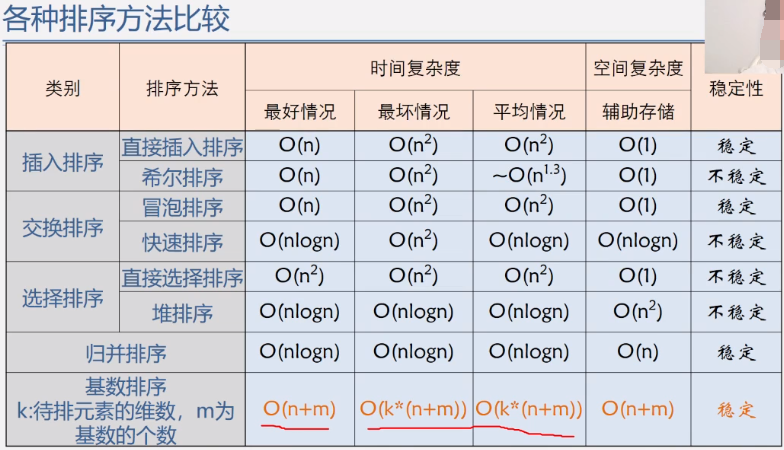
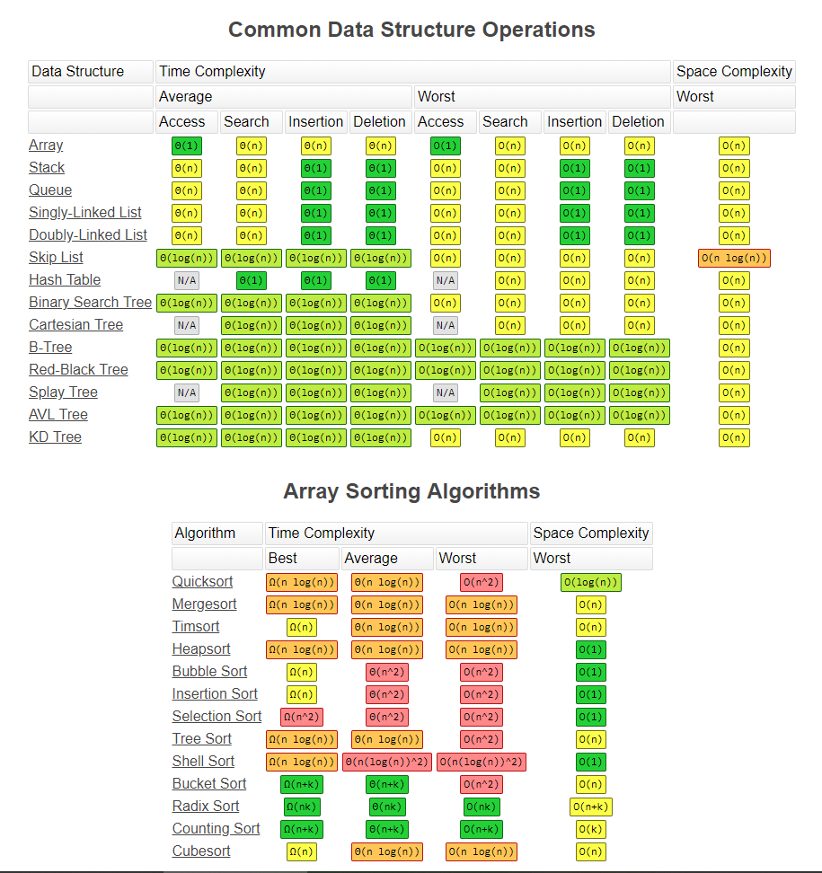

**脑图分享,之前失效的URL, 请查看这个:[脑图笔记](https://mubu.com/doc/2ZN7M-lA91C),因手贱被我重置啦,抱歉.**

# 学习算法,终生学习.

> 算法本质是使程序片段执行得到一种最优最快的方法,
从而实现计算量最少最优,CPU占用最低,响应最快的结果.

<!-- TOC -->

- [学习算法,终生学习.](#%E5%AD%A6%E4%B9%A0%E7%AE%97%E6%B3%95%E7%BB%88%E7%94%9F%E5%AD%A6%E4%B9%A0)
    - [1. 实战算法](#1-%E5%AE%9E%E6%88%98%E7%AE%97%E6%B3%95)
    - [2. 图解算法](#2-%E5%9B%BE%E8%A7%A3%E7%AE%97%E6%B3%95)
    - [3. 数据结构图谱](#3-%E6%95%B0%E6%8D%AE%E7%BB%93%E6%9E%84%E5%9B%BE%E8%B0%B1)
    - [4. 算法好坏基本判断](#4-%E7%AE%97%E6%B3%95%E5%A5%BD%E5%9D%8F%E5%9F%BA%E6%9C%AC%E5%88%A4%E6%96%AD)
    - [5. 如何分析算法题](#5-%E5%A6%82%E4%BD%95%E5%88%86%E6%9E%90%E7%AE%97%E6%B3%95%E9%A2%98)
    - [6. 蓝蝙蝠算法系列](#6-%E8%93%9D%E8%9D%99%E8%9D%A0%E7%AE%97%E6%B3%95%E7%B3%BB%E5%88%97)
    - [7. 排序](#7-%E6%8E%92%E5%BA%8F)
        - [7.1. 排序的总结](#71-%E6%8E%92%E5%BA%8F%E7%9A%84%E6%80%BB%E7%BB%93)
    - [8. 列表](#8-%E5%88%97%E8%A1%A8)
    - [9. 树](#9-%E6%A0%91)
    - [10. 贪心思想](#10-%E8%B4%AA%E5%BF%83%E6%80%9D%E6%83%B3)
    - [11. 动态规划](#11-%E5%8A%A8%E6%80%81%E8%A7%84%E5%88%92)
    - [12. 递归题](#12-%E9%80%92%E5%BD%92%E9%A2%98)
    - [13. 各种算法已代码实现](#13-%E5%90%84%E7%A7%8D%E7%AE%97%E6%B3%95%E5%B7%B2%E4%BB%A3%E7%A0%81%E5%AE%9E%E7%8E%B0)
    - [14. Common Data Structure Operations](#14-common-data-structure-operations)
        - [14.1. 时间复杂度](#141-%E6%97%B6%E9%97%B4%E5%A4%8D%E6%9D%82%E5%BA%A6)
    - [15. 学习笔记](#15-%E5%AD%A6%E4%B9%A0%E7%AC%94%E8%AE%B0)

<!-- /TOC -->

## 1. 实战算法

> 提供golang,php,c语言及多种解法实现.详细每一个步骤

1. [https://github.com/yezihack/leetcode](https://github.com/yezihack/leetcode)

## 2. 图解算法

[https://visualgo.net/](https://visualgo.net/)

## 3. 数据结构图谱

## 4. 算法好坏基本判断

1. 时间复杂度,使用大O表示法.如O(1), O(n), O(LogN)
1. 空间复杂度.

## 5. 如何分析算法题

1. 找到数据之间的规律,得出通用公式
1. 将大问题不断缩小范围,得到一个最小范围解
1. 借用空间换时间.

## 6. 蓝蝙蝠算法系列

1. [数组转换成最小值](24.蓝蝙蝠面试算法/01.数组转换成最小值.go)

## 7. 排序

1. [冒泡排序](16.排序算法/03.冒泡排序.go)
1. [插入排序](16.排序算法/01.插入排序.go)
1. [选择排序](16.排序算法/05.简单选择排序.go)
1. [希尔排序](16.排序算法/02.希尔排序.go)
1. [归并排序](16.排序算法/08.归并排序.go)
1. [快速排序](16.排序算法/04.快速排序.go)

### 7.1. 排序的总结

## 8. 列表

1. [斐波那契数列](fibonacci/main.go) chan实现
1. [二分法实现](dichotomy/demo.go) 多种写法
1. [双链表实现](DoubleLinedList/README.md) 并发安全
1. [FIFO先进先出算法实现](Cache/README.md) 双链表实现
1. [LRU最少最近算法实现](Cache/README.md) 双链表实现
1. [LFU最不常用算法实现](Cache/README.md) 双链表实现

## 9. 树

1. [基本定义与概念](tree/README.md)
1. [二叉树基本操作](tree/binary_tree.go)
1. [哈夫曼树](tree/huffman_tree.go)

## 10. 贪心思想

1. [非负整数a,删除k个元素,求最大值](21.贪心思想/01.求最大值.go)

## 11. 动态规划

1 [最长公共子串](23.动态规划/02.最长公共子串.go)
1 [最长公共子序列](23.动态规划/03.公共子序列.go)

## 12. 递归题

1. [顺时针打印矩阵](01.递归算法/07.顺时针打印矩阵.go)

## 13. 各种算法已代码实现

1. 极客时间算法: https://github.com/wangzheng0822/algo

## 14. Common Data Structure Operations

1. http://www.bigocheatsheet.com/

### 14.1. 时间复杂度

## 15. 学习笔记

1. [王卓老师的<<数据结构与算法>>](https://www.bilibili.com/read/cv3285768)
2. [脑图笔记](https://mubu.com/explore/7fyi5I30ZbC) 
3. [代码实现](https://github.com/yezihack/algo)
4. 仅供同学们参考
